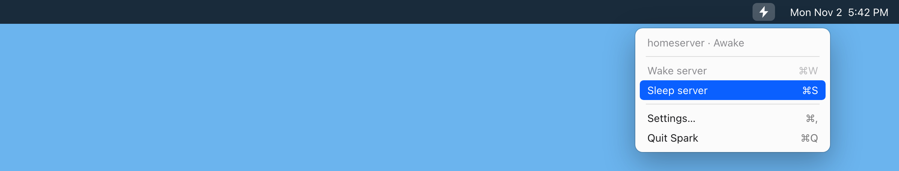
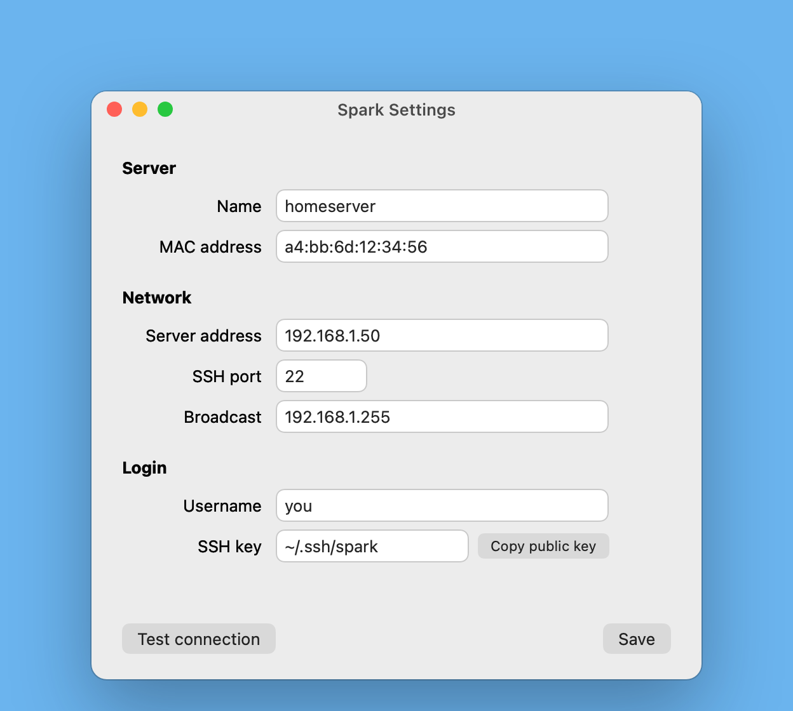
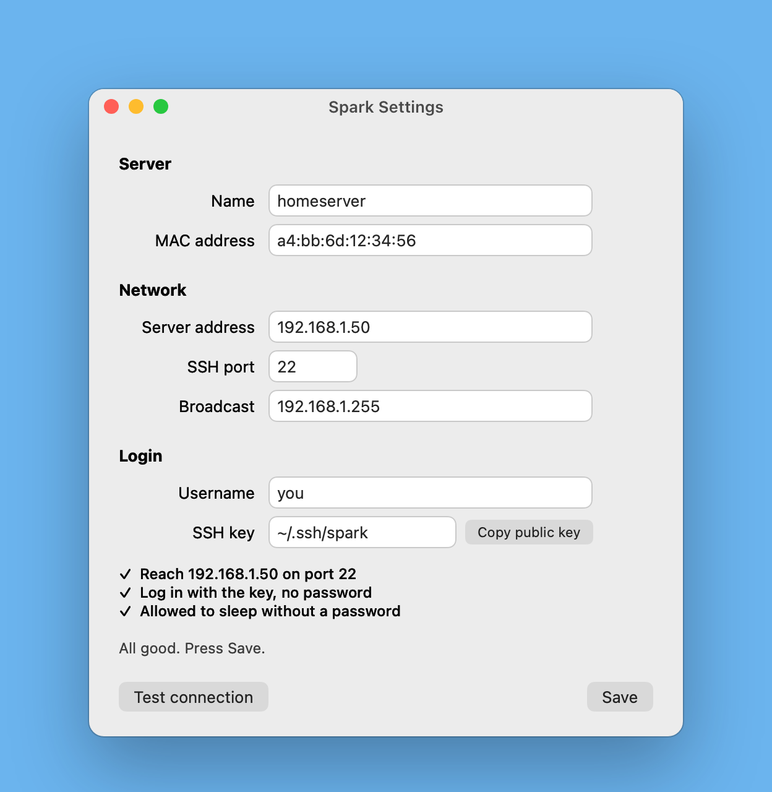

# Spark

Wake your home server and put it back to sleep from your Mac's menu bar, so it only uses power when you need it.

**[spark.koryei.tech](https://spark.koryei.tech)**



<p>


</p>

## Install

1. Download `Spark.zip` from the [latest release](https://github.com/koryei/spark/releases/latest) and drag **Spark.app** into Applications.
2. Right-click it and choose **Open** the first time.
3. Follow the **[setup guide](docs/setup.md)** to connect it to your server. It takes about 15 minutes and checks each step as you go.

Requires macOS 13 or newer and a Linux server on the same network.

## How it works

- **Wake server** sends a Wake-on-LAN signal to your server.
- **Sleep server** tells your server to sleep over SSH, using a key, so there's no password to type.
- The menu shows whether the server is awake or asleep.

## Build it yourself

```sh
cd app && ./build.sh && open build/Spark.app
```

Needs the Xcode command line tools (`xcode-select --install`).
